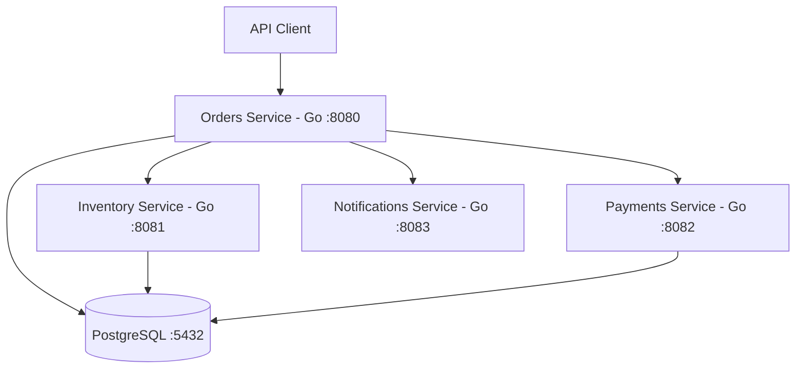

# Cloud-Native Online Marketplace

A Go-based microservices application demonstrating order processing, inventory management, simulated payment processing, and customer notifications using Docker and PostgreSQL.

## Architecture



## Features

- **Microservices architecture:** Separate services for orders, inventory, payments, and notifications.
- **Inventory management:** Stock reservation and release with quantity validation.
- **Order processing:** Tracks order status through the payment workflow.
- **Idempotent payments:** Prevents duplicate payment records for repeated matching requests.
- **PostgreSQL persistence:** Stores orders, stock, and payment records.
- **Docker Compose:** Runs the application services and database together.
- **Automated tests:** Unit tests and integration tests for key success and failure scenarios.

## Technology Stack

- **Language:** Go
- **Database:** PostgreSQL
- **Containers:** Docker and Docker Compose
- **Testing:** Go testing package
- **API format:** HTTP and JSON

## Prerequisites

Install the following before running the project:

- Go compatible with the version specified in `go.mod`
- Docker Desktop with Docker Compose
- Git (optional, for version control)

## Run Locally

Clone the repository if you're starting from GitHub:

```bash
git clone YOUR_REPOSITORY_URL
cd cloud_native_marketplace
```

Build and start the services:

```powershell
docker compose up --build -d
```

Check the running containers:

```powershell
docker compose ps
```

## Service Endpoints

| Service | URL |
|---|---|
| Orders | `http://localhost:8080` |
| Inventory | `http://localhost:8081` |
| Payments | `http://localhost:8082` |
| Notifications | `http://localhost:8083` |

API details and example requests are documented in [`API.md`](API.md).

## Example: Create an Order

```powershell
Invoke-RestMethod `
  -Uri "http://localhost:8080/orders" `
  -Method Post `
  -ContentType "application/json" `
  -Body '{"sku":"BOOK-001","quantity":1,"amount_cents":50000,"customer_email":"customer@example.com"}'
```

This request uses the seeded `BOOK-001` SKU. It should succeed if sufficient stock is available and the dependent services are healthy.

## Run Tests

From the project root:

```powershell
go test -count=1 ./...
```

Integration tests require the relevant Docker services to be running.

## Stop the Application

```powershell
docker compose down
```

This stops and removes the containers but preserves the named PostgreSQL data volume.

## Current Limitations

- Payments are simulated and do not charge real money.
- Notification events are stored in memory and are lost when the Notifications service restarts.
- Production deployment would require additional security, monitoring, secrets management, and operational hardening.

## Future Improvements

- Add persistent notification storage or a message broker.
- Add authentication and authorization.
- Add structured logging and metrics.
- Implement CI workflows for automated testing.
- Deploy to a cloud platform.

## License

Add a license before distributing the project publicly. If you choose an open-source license, include its full text in a `LICENSE` file.